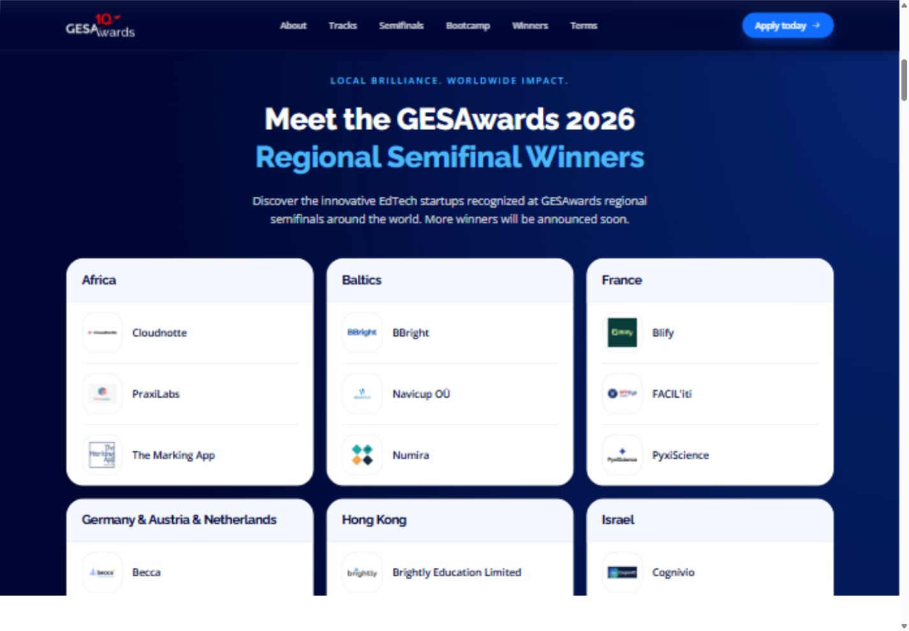
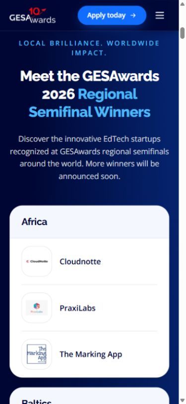

# Regional semifinal winners

Implemented on `codex/regional-semifinal-winners`. No production deployment, merge, or Airtable write was performed.

## Behavior

The homepage displays the exact requested heading and introduction, followed by a single alphabetical company gallery with equally sized logo areas and company names. No region cards or region labels are displayed. Each tile shows the startup country from the startup record's `country text` field (normalized, e.g. "USA - Tennessee" -> "USA"); it is omitted when empty. The three placement fields determine membership only; placement data is never passed to the UI. Repeated record IDs are deduplicated across the entire gallery, including companies recognized in multiple semifinals.

The existing server-side Airtable reader is shared by the schedule and winners. It fetches only selected fields, paginates, and caches for 300 seconds using the existing `semifinals` cache tag. Startup lookups are batched by linked record ID. The homepage also revalidates every 300 seconds so an initial upstream failure does not permanently omit the section. Refresh is traffic-driven, using Next.js stale-while-revalidate semantics.

Only `AIRTABLE_API_KEY` is needed; no new environment variables or dependencies. No registration contact details are fetched. Missing credentials or an upstream failure omit the section without breaking the homepage. There is no manually maintained winners snapshot. Logos use Airtable thumbnails where available, with initials for missing, invalid or failed images. Attachment URLs expire, so time-based refresh is important; during an extended Airtable outage, expired logos can fall back to initials.

## Live Airtable verification — 23 November 2026

Read the requested view `viwAO4gA7Bf1RjJCT` in Semifinals `tblAJHZRBQyfPOySc`, base `appyTu8uOPQUVXD4x`, and linked startup names/logos in `tblvXv2QLUDoMBs2Y`.

- 23 semifinals in the view; 15 contain winners; 46 distinct winning startups.
- Source fields contain 16, 15 and 15 links respectively. All are represented.
- Spain & Portugal has two startups in each placement field; all six appear equally.
- All 46 links resolve to named startups with logo attachments; no missing names or logo attachments were found.
- U.K. currently has one recorded winner. Eight semifinals have no recorded winners and are omitted. Missing placements are not filled in.
- No individual startup profile route exists in this repository, so cards do not invent profile links.

## Checks

- `npm run build`: passed; homepage is prerendered with five-minute revalidation.
- `npx tsc --noEmit`: passed (there is no package typecheck script).
- `npm run lint`: fails on three pre-existing `@typescript-eslint/no-require-imports` errors in `scripts/download_bootcamp_speakers.js` and `scripts/extract_all_wix_speakers.js`. Targeted lint of all changed TS/TSX/MJS files passed.
- `node --experimental-strip-types --disable-warning=MODULE_TYPELESS_PACKAGE_JSON --test scripts/test-regional-winners.mjs`: five tests passed, covering all fields, ties, repeated links, empty/unresolved records, logo fallback, cross-region recognition, missing credentials and HTTP 503 handling.
- `node --experimental-strip-types --disable-warning=MODULE_TYPELESS_PACKAGE_JSON scripts/verify-regional-winners.mjs`: read-only live data audit passed.
- Browser checked against the production build at 1440×1000 and 390×844: 46 unique company tiles in one gallery, no horizontal overflow, no ranking or Global Finalist copy in the section, no browser console warnings/errors captured. Long startup names wrap. The gallery uses two columns on mobile and five on wide desktop screens.
- Scanned 996 public build files (client assets and rendered HTML/RSC) for the configured Airtable credential: zero matches. Server-only imports protect the data modules.

## Files

- `app/page.tsx`: homepage integration and revalidation.
- `components/home/RegionalWinners.tsx`: responsive server-rendered showcase.
- `components/home/WinnerLogo.tsx`: small client component for image failure fallback.
- `lib/content/airtable-read.ts`: shared server-only paginated, cached reader.
- `lib/content/semifinals-airtable.ts`: reuse shared reader without changing schedule mapping.
- `lib/content/regional-winners.ts`: winner and linked-startup queries with graceful failure handling.
- `lib/content/regional-winners-data.ts`: pure membership, deduplication and display-data adapter.
- `scripts/test-regional-winners.mjs`: regression checks.
- `scripts/verify-regional-winners.mjs`: repeatable, read-only live audit.
- This report, `desktop.jpg` and `mobile.jpg`.

## Screenshots

No hosted preview deployment was created. Run `npm run build` and `npm run start -- --port 3100`, then open `http://localhost:3100/#regional-winners` for a local production preview.
